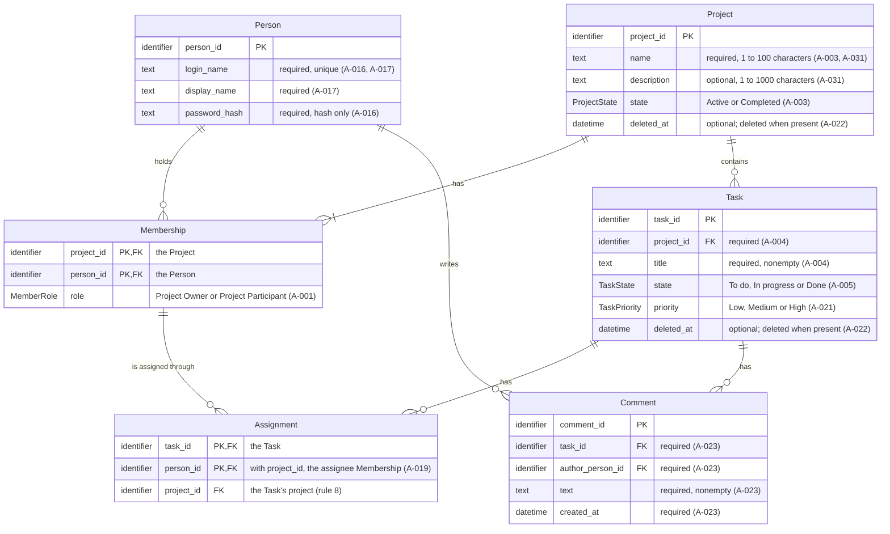

# Matriz — Data Model (v0.6)

**Status:** **Proposal pending validation — not an approved design.** The client has not approved the MVP scope ([OQ-016](constraints.md#open-questions)), and every rule below that goes beyond F01–F03 rests on an unvalidated assumption. Revised on 2026-10-29 for the project team's provisional decisions ([ADR-002](adr/ADR-002-phase-scope-and-implementation-authorization.md)); changed entries are marked *Changed in v0.2* or *New in v0.2* and listed in the [change log](#change-log). Revised again on 2026-10-30 (v0.3) for the physical schema ([ADR-007](adr/ADR-007-build-persistence-and-demonstration-data.md)); those entries are marked with that date. Revised on 2026-10-30 (v0.4) by team decision in the review of increment I1, for the demonstration data migration and the aggregates ([ADR-008](adr/ADR-008-domain-driven-design.md)); those entries are marked “v0.4”, and the logical model is unchanged. Revised on 2026-11-02 (v0.5) by team decision for increment I2 (the conversation “Lab Worksheet 03 — access to the application”), for login names in lower case and the technical table of ended access tokens ([ADR-005](adr/ADR-005-authentication-with-jwt.md), [ADR-007](adr/ADR-007-build-persistence-and-demonstration-data.md)); those entries are marked “v0.5”, and the logical model is unchanged. It is a logical model: it defines no physical schema. The team has provisionally chosen a relational database ([ADR-003](adr/ADR-003-technology-stack.md)); the physical schema will be derived from this model by versioned migrations during implementation ([implementation plan](implementation-plan.md)). Terminology follows the [glossary](requirements.md#glossary).

**Physical schema.** *Added on 2026-10-30 by team decision ([ADR-007](adr/ADR-007-build-persistence-and-demonstration-data.md), decision 8; v0.3):* the schema derived from this model is created by the versioned migrations in [`src/main/resources/db/migration/`](../src/main/resources/db/migration/), starting with [`V1__create_schema.sql`](../src/main/resources/db/migration/V1__create_schema.sql). ADR-007 records the identifier type, how enumerations are stored, the text constraints, and which of the [rules](#rules-not-shown-in-the-diagram) the database enforces. Where the schema and this model differ, the difference is flagged here. *Added on 2026-10-30 by team decision in the I1 review ([ADR-007](adr/ADR-007-build-persistence-and-demonstration-data.md), decision 10, amended; v0.4):* the demonstration data is not part of the schema. A separate migration, [`V1_1__demonstration_data.sql`](../src/main/resources/db/demo/V1_1__demonstration_data.sql), adds it only to a database for which it is requested.

The model covers only the proposed MVP, [FR-001–FR-025](requirements.md#functional-requirements) ([Assumption A-012](constraints.md#assumptions)), and the data on which [NFR-001–NFR-003](requirements.md#non-functional-requirements-and-unresolved-quality-criteria) depend. Nothing is modelled for the candidates [outside the initial scope](requirements.md#outside-the-initial-scope). Requirements and acceptance criteria are linked, not repeated.

## Entities

| Entity | Represents | Identifier | Stored attributes |
|---|---|---|---|
| Person | A person known to the application, who signs in and to whom memberships, assignments, and comments refer ([NFR-001](requirements.md#non-functional-requirements-and-unresolved-quality-criteria); [Assumption A-014](constraints.md#assumptions), [Assumption A-016](constraints.md#assumptions)). | `person_id` | `login_name`: required and unique, so that signing in identifies one person ([Assumption A-016](constraints.md#assumptions), [Assumption A-017](constraints.md#assumptions)). *Changed on 2026-11-02 (v0.5) by team decision (Lab Worksheet 03, question 10; [ADR-007](adr/ADR-007-build-persistence-and-demonstration-data.md#open-points), “Case of login names”): login names are case-insensitive, so `login_name` is stored in lower case; the migration [`V3__require_lower_case_login_names.sql`](../src/main/resources/db/migration/V3__require_lower_case_login_names.sql) adds the check.* `display_name`: required; shown to the members of the person's projects ([Assumption A-017](constraints.md#assumptions), [Assumption A-027](constraints.md#assumptions)). `password_hash`: required; only a one-way hash of the password is stored, never the password itself ([Assumption A-016](constraints.md#assumptions); [ADR-005](adr/ADR-005-authentication-with-jwt.md)). *Changed in v0.2: previously no attributes.* |
| Project | A [Project](requirements.md#glossary) (F01). | `project_id` | `name`: required, 1 to 100 characters after trimming ([Assumption A-003](constraints.md#assumptions), [Assumption A-031](constraints.md#assumptions)). `description`: optional, 1 to 1000 characters when present, stored trimmed; absent means “no description” ([Assumption A-031](constraints.md#assumptions)). `state`: Active or Completed ([Assumption A-003](constraints.md#assumptions)). `deleted_at`: optional date and time of deletion; when present, the project is deleted ([Assumption A-022](constraints.md#assumptions)). *Changed in v0.2: `deleted_at`. Changed in v0.6 (2026-11-02): `name` limited to 100 characters and `description` added; previously “`name`: required and nonempty”.* |
| Membership | A person's membership of a project, which makes them a [Member](requirements.md#glossary) with access to it ([Assumption A-002](constraints.md#assumptions)). | `project_id` + `person_id`: at most one Membership per person and project, because Project Owner and Project Participant are distinct per-project roles ([Assumption A-001](constraints.md#assumptions)). | `role`: Project Owner or Project Participant ([Assumption A-001](constraints.md#assumptions)). |
| Task | A [Task](requirements.md#glossary) (F02). | `task_id` | `project_id`: required; the project the task belongs to ([Assumption A-004](constraints.md#assumptions)). `title`: required and nonempty ([Assumption A-004](constraints.md#assumptions)). `state`: To do, In progress, or Done ([Assumption A-005](constraints.md#assumptions)). `priority`: Low, Medium, or High ([Assumption A-021](constraints.md#assumptions)). `deleted_at`: optional date and time of deletion; when present, the task is deleted ([Assumption A-022](constraints.md#assumptions)). *Changed in v0.2: `priority` and `deleted_at` added; `assignee_person_id` replaced by Assignment.* *Changed on 2026-10-30 (v0.3) by team decision ([ADR-007](adr/ADR-007-build-persistence-and-demonstration-data.md), decision 8): the physical schema adds a technical `creation_order`, generated by the database, for the oldest-first task list; it is not a business attribute and the API never exposes it.* |
| Assignment | A member's assignment to a task, which makes them one of its [Assignees](requirements.md#glossary) ([Assumption A-019](constraints.md#assumptions)). | `task_id` + `person_id`: a member is assigned to the same task at most once ([FR-010](requirements.md#functional-requirements)). | `project_id`: the task's project; with `person_id`, it identifies the assignee's Membership (rule 8). *New in v0.2.* |
| Comment | A [Comment](requirements.md#glossary) on a task ([Assumption A-023](constraints.md#assumptions)). | `comment_id` | `task_id`: required; the task commented on. `author_person_id`: required; the Person who added it. `text`: required and nonempty. `created_at`: required; the date and time it was added ([Assumption A-023](constraints.md#assumptions)). *New in v0.2.* |

- `project_id`, `task_id`, and `comment_id` carry no business meaning, because names and titles can change ([FR-003](requirements.md#functional-requirements), [FR-009](requirements.md#functional-requirements)) and whether they must be unique is open ([OQ-003](constraints.md#open-questions)). No uniqueness is assumed for `name` or `title`.
- Ownership is the `role` of a Membership, not a separate reference on Project, so the Project Owner is a member by construction ([Assumption A-002](constraints.md#assumptions), [Assumption A-008](constraints.md#assumptions)) and a person can hold different roles in different projects ([Assumption A-001](constraints.md#assumptions)).
- Assignments are a separate entity because a task can have several assignees ([FR-010](requirements.md#functional-requirements); [Assumption A-019](constraints.md#assumptions)). No assignment history is required: unassigning removes the Assignment. *Changed in v0.2.*
- Deletion is recorded in `deleted_at` instead of removing data, because deleted projects and tasks are kept ([Assumption A-022](constraints.md#assumptions)). *New in v0.2.*
- A Comment's author refers to the Person, not to their Membership, so that a comment keeps its author after the author leaves the project ([FR-005](requirements.md#functional-requirements), [FR-021](requirements.md#functional-requirements)). *New in v0.2.*
- In the code, these entities form four aggregates: Person; Project, with its Memberships; Task, with its Assignments; and Comment. The grouping adds no rule; [ADR-008](adr/ADR-008-domain-driven-design.md) (decision 2) lists the [rules](#rules-not-shown-in-the-diagram) that each aggregate keeps. *Added on 2026-10-30 by team decision in the I1 review (v0.4).*

## Relationships

| Relationship | Cardinality and optionality | Basis |
|---|---|---|
| Person – Membership | Each Person holds `0..*` Memberships (optional); each Membership belongs to `1` Person (mandatory). | A person need not belong to any project; for example, a person authorized to create projects may not have created one yet ([US-001](user-stories.md#stories)). |
| Project – Membership | Each Project has `1..*` Memberships (mandatory), exactly one with role Project Owner (rule 1); each Membership belongs to `1` Project (mandatory). | The creator's Membership exists from creation ([FR-002](requirements.md#functional-requirements); [Assumption A-008](constraints.md#assumptions)), and no MVP requirement removes it ([FR-005](requirements.md#functional-requirements); [Assumption A-009](constraints.md#assumptions)). |
| Project – Task | Each Project contains `0..*` Tasks (optional); each Task belongs to `1` Project (mandatory). | A project can have no tasks ([US-006](user-stories.md#acceptance-criteria), [EX-005](user-stories.md#edge-cases-and-exceptions)); a task belongs to exactly one project ([Assumption A-004](constraints.md#assumptions)). |
| Task – Assignment | Each Task has `0..*` Assignments (optional); each Assignment belongs to `1` Task (mandatory). | A task may be unassigned or have several assignees ([FR-008](requirements.md#functional-requirements), [FR-010](requirements.md#functional-requirements); [Assumption A-019](constraints.md#assumptions)). *Changed in v0.2.* |
| Membership – Assignment | Each Membership has `0..*` Assignments (optional); each Assignment belongs to `1` Membership (mandatory), of the Task's own Project (rule 8). | Only members of the task's project can be assigned ([Assumption A-019](constraints.md#assumptions)); no requirement limits the number of tasks per assignee. *Changed in v0.2.* |
| Task – Comment | Each Task has `0..*` Comments (optional); each Comment belongs to `1` Task (mandatory). | [FR-020](requirements.md#functional-requirements), [FR-021](requirements.md#functional-requirements); [Assumption A-023](constraints.md#assumptions). *New in v0.2.* |
| Person – Comment | Each Person is the author of `0..*` Comments (optional); each Comment has `1` author (mandatory). | [FR-020](requirements.md#functional-requirements); [Assumption A-023](constraints.md#assumptions). *New in v0.2.* |

Through Membership, Person and Project are related many-to-many; a person can be Project Owner in some projects and Project Participant in others ([Assumption A-001](constraints.md#assumptions)). Through Assignment, Membership and Task are also related many-to-many.

## ER diagram

- Next to an entity, `||` means exactly one, `|o` zero or one, `|{` one or more, and `o{` zero or more instances of that entity for each instance at the other end of the line.
- A solid line joins an entity to one it cannot exist without. Since v0.2 every line is solid: an Assignment cannot exist without its Task and Membership, nor a Comment without its Task and author.
- `PK` marks identifiers and `FK` references to another entity; attribute types are conceptual value sets. None of these implies a storage technology.
- Assumption IDs in the diagram refer to the [assumption register](constraints.md#assumptions); all are unvalidated.

## Rules not shown in the diagram

ER cardinality markers cannot express these rules.

1. **One Project Owner.** Exactly one Membership of each Project has role Project Owner: its creator's, recorded when the Project is created ([FR-002](requirements.md#functional-requirements); [Assumption A-001](constraints.md#assumptions), [Assumption A-008](constraints.md#assumptions)). Members added later are Project Participants ([US-002](user-stories.md#stories)). No MVP requirement adds another owner, transfers ownership, or removes the owner ([FR-005](requirements.md#functional-requirements); [OQ-002](constraints.md#open-questions), [OQ-008](constraints.md#open-questions)).
2. **Member removal.** A Membership can be removed only if its role is Project Participant, its Project is Active, and no Assignment references it ([FR-005](requirements.md#functional-requirements); [Assumption A-009](constraints.md#assumptions)). Unassigning the member ([FR-010](requirements.md#functional-requirements), [FR-019](requirements.md#functional-requirements)) or deleting their tasks ([FR-017](requirements.md#functional-requirements); rule 6) makes removal possible. Removal ends the person's access ([Assumption A-002](constraints.md#assumptions)); only current memberships are recorded, and the person's Comments keep them as author. *Changed in v0.2.*
3. **Initial values.** A new Project is Active ([FR-002](requirements.md#functional-requirements); [Assumption A-003](constraints.md#assumptions)); a new Task is To do, may have no Assignment, and has Task priority Medium unless the Project Owner chooses another ([FR-008](requirements.md#functional-requirements), [FR-018](requirements.md#functional-requirements); [Assumption A-004](constraints.md#assumptions), [Assumption A-010](constraints.md#assumptions), [Assumption A-021](constraints.md#assumptions)). Neither is deleted. *Changed in v0.2.*
4. **State changes.** The only specified Project change of state is from Active to Completed, by its Project Owner, when none of its Tasks that are not deleted is To do or In progress ([FR-007](requirements.md#functional-requirements); [Assumption A-003](constraints.md#assumptions), [Assumption A-007](constraints.md#assumptions), [Assumption A-022](constraints.md#assumptions)); reopening is open ([OQ-006](constraints.md#open-questions)). A Task's state can change between any of its three values ([FR-011](requirements.md#functional-requirements); [Assumption A-005](constraints.md#assumptions)). *Changed in v0.2: deleted tasks.*
5. **Completed projects are read-only, except for comments.** While a Project is Completed, the Project does not change and cannot be deleted, and none of its Memberships, Tasks, or Assignments is added, removed, changed, or deleted ([FR-004](requirements.md#functional-requirements), [FR-005](requirements.md#functional-requirements), [FR-008](requirements.md#functional-requirements), [FR-016](requirements.md#functional-requirements), [FR-017](requirements.md#functional-requirements); [Assumption A-011](constraints.md#assumptions), [Assumption A-022](constraints.md#assumptions)). Comments can still be added ([FR-020](requirements.md#functional-requirements); [Assumption A-023](constraints.md#assumptions)). With rule 4, every Task of a Completed Project that is not deleted is therefore Done, because simultaneous changes are applied as one indivisible change ([Assumption A-029](constraints.md#assumptions); [ADR-006](adr/ADR-006-simultaneous-changes.md)). *Changed in v0.2.*
6. **Deletion.** A Project or Task with `deleted_at` is treated as nonexistent: it is not listed or counted, and it cannot be viewed or changed; `deleted_at` is never cleared. Deleting a Task removes its Assignments, and its Comments are kept but hidden with it. Deleting a Project hides its Memberships, Tasks, Assignments, and Comments with it, unchanged ([FR-016](requirements.md#functional-requirements), [FR-017](requirements.md#functional-requirements); [Assumption A-022](constraints.md#assumptions)). *New in v0.2.*
7. **Comments are not changed.** A Comment is never changed or removed by the application once added ([Assumption A-023](constraints.md#assumptions)). *New in v0.2.*
8. **Assignments stay within the project.** An Assignment's `project_id` equals its Task's `project_id`, and with `person_id` it identifies a Membership of that Project; only members of the task's project can therefore be assigned ([Assumption A-019](constraints.md#assumptions)). *New in v0.2.*

## Stored and derived data

Only the attributes in the diagram are stored. Everything else that the MVP shows or checks is derived from them when needed and is not stored, so it cannot diverge from the stored data. *Exception added on 2026-10-30 (v0.3) by team decision ([ADR-007](adr/ADR-007-build-persistence-and-demonstration-data.md), decision 8): Task's technical `creation_order` is stored too, because random identifiers carry no creation order.* *Exception added on 2026-11-02 (v0.5) by team decision (Lab Worksheet 03, question 3; [ADR-005](adr/ADR-005-authentication-with-jwt.md#open-points), “How sign-out is enforced”): the technical table `ended_access_token`, created by the migration [`V2__create_ended_access_token.sql`](../src/main/resources/db/migration/V2__create_ended_access_token.sql), stores the identifier and expiry time of each access token ended by signing out. It is not an entity of this model and refers to no person. It stores no token, only the token's random identifier. Each sign-out deletes the rows of tokens that have expired.*

| Derived value | Derived from | Used by |
|---|---|---|
| Task counts by state, percentage Done, or “No tasks” | `state` of the project's Tasks that are not deleted | [FR-012](requirements.md#functional-requirements), [FR-024](requirements.md#functional-requirements), [EX-005](user-stories.md#edge-cases-and-exceptions), [EX-027](user-stories.md#edge-cases-and-exceptions); [Assumption A-006](constraints.md#assumptions), [Assumption A-022](constraints.md#assumptions), [Assumption A-026](constraints.md#assumptions) |
| Whether a project has unfinished tasks | Any of its Tasks that are not deleted in To do or In progress | [FR-007](requirements.md#functional-requirements); [Assumption A-007](constraints.md#assumptions), [Assumption A-022](constraints.md#assumptions) |
| Whether a member has assigned tasks | Any Assignment referencing their Membership | [FR-005](requirements.md#functional-requirements); [Assumption A-009](constraints.md#assumptions) |
| A person's accessible projects; a project's members and its Project Owner | Memberships and their `role`, for Projects that are not deleted | [FR-001](requirements.md#functional-requirements), [FR-022](requirements.md#functional-requirements), [FR-024](requirements.md#functional-requirements), [FR-025](requirements.md#functional-requirements), [US-001](user-stories.md#acceptance-criteria), [US-002](user-stories.md#acceptance-criteria); [Assumption A-002](constraints.md#assumptions), [Assumption A-022](constraints.md#assumptions), [Assumption A-027](constraints.md#assumptions) |
| A task's assignees, or whether it is unassigned | The Task's Assignments | [FR-006](requirements.md#functional-requirements), [FR-008](requirements.md#functional-requirements) |
| Project search and task filter results | Project `name`; Task `state` and `priority` | [FR-022](requirements.md#functional-requirements), [FR-023](requirements.md#functional-requirements); [Assumption A-024](constraints.md#assumptions) |
| Whether a person may view or change a project or task | Membership, `role`, the Task's Assignments, the Project's `state`, and `deleted_at` | [NFR-002](requirements.md#non-functional-requirements-and-unresolved-quality-criteria); [Assumption A-001](constraints.md#assumptions), [Assumption A-002](constraints.md#assumptions), [Assumption A-011](constraints.md#assumptions), [Assumption A-020](constraints.md#assumptions), [Assumption A-022](constraints.md#assumptions); checked on every API request ([ADR-004](adr/ADR-004-rest-api-single-entry-point.md)) |

Project `state` is stored rather than derived: Completed records the Project Owner's decision ([FR-007](requirements.md#functional-requirements)); task states only determine whether that decision is allowed. A Comment's `created_at` is stored because it records when the comment was added.

## Consistency review

### Requirement coverage

| Requirement | Model elements |
|---|---|
| [FR-001](requirements.md#functional-requirements) | The person's Memberships; Project `state` (Completed projects stay listed) and `deleted_at` |
| [FR-002](requirements.md#functional-requirements) | New Project (Active) with its `name` and optional `description`, and its creator's Membership (Project Owner); any signed-in person may create projects ([Assumption A-018](constraints.md#assumptions)), so no data represents this authorization |
| [FR-003](requirements.md#functional-requirements) | Project `name` and `description` |
| [FR-004](requirements.md#functional-requirements) | New Membership (Project Participant) |
| [FR-005](requirements.md#functional-requirements) | Membership removal (rule 2) |
| [FR-006](requirements.md#functional-requirements) | Task `title`, `state`, `priority`, and Assignments |
| [FR-007](requirements.md#functional-requirements) | Project `state`; derived unfinished-task check (rule 4) |
| [FR-008](requirements.md#functional-requirements) | New Task (To do, no Assignment required) |
| [FR-009](requirements.md#functional-requirements) | Task `title` |
| [FR-010](requirements.md#functional-requirements) | Assignments referencing Memberships of the task's project (rule 8) |
| [FR-011](requirements.md#functional-requirements) | Task `state`; permission derived from `role` and Assignments |
| [FR-012](requirements.md#functional-requirements) | Derived values only, not counting deleted Tasks |
| [FR-013](requirements.md#functional-requirements) | Person `login_name` and `password_hash` |
| [FR-014](requirements.md#functional-requirements) | No business data; any data needed to end a sign-in is technical and decided with [ADR-005](adr/ADR-005-authentication-with-jwt.md). *Changed on 2026-11-02 (v0.5): decided; the technical table `ended_access_token` (see [Stored and derived data](#stored-and-derived-data)).* |
| [FR-015](requirements.md#functional-requirements) | Person `display_name` |
| [FR-016](requirements.md#functional-requirements) | Project `deleted_at` (rule 6) |
| [FR-017](requirements.md#functional-requirements) | Task `deleted_at`; removal of its Assignments (rule 6) |
| [FR-018](requirements.md#functional-requirements) | Task `priority` (rule 3) |
| [FR-019](requirements.md#functional-requirements) | Assignments of the signed-in person's own Membership |
| [FR-020](requirements.md#functional-requirements) | New Comment (rules 5 and 7) |
| [FR-021](requirements.md#functional-requirements) | The Task's Comments in `created_at` order; the author's `display_name` |
| [FR-022](requirements.md#functional-requirements) | Project `name`; derived accessible projects |
| [FR-023](requirements.md#functional-requirements) | Task `state` and `priority` |
| [FR-024](requirements.md#functional-requirements) | Derived accessible projects and their task counts by state |
| [FR-025](requirements.md#functional-requirements) | Memberships, their `role`, and Person `display_name` |
| [NFR-001](requirements.md#non-functional-requirements-and-unresolved-quality-criteria) | Person `login_name` and `password_hash` ([Assumption A-016](constraints.md#assumptions); [OQ-018](constraints.md#open-questions)) |
| [NFR-002](requirements.md#non-functional-requirements-and-unresolved-quality-criteria) | Membership, `role`, Assignments, Project `state`, and `deleted_at` |
| [NFR-003](requirements.md#non-functional-requirements-and-unresolved-quality-criteria) | Person `login_name` and `display_name`; Memberships, Assignments, and Comments (free text and author) link people to projects and tasks; deleted items are kept with no retention period ([Assumption A-022](constraints.md#assumptions)). What personal data is processed and which obligations apply is open ([OQ-011](constraints.md#open-questions)) |

### Findings

| Check | Result |
|---|---|
| Membership and ownership | Consistent with [Assumption A-001](constraints.md#assumptions), [Assumption A-002](constraints.md#assumptions), and [Assumption A-008](constraints.md#assumptions). **Flag:** “exactly one Project Owner” (rule 1) is inferred from the singular “its Project Owner” and from the absence of any way to add, transfer, or remove an owner; it is not stated explicitly ([OQ-002](constraints.md#open-questions), [OQ-008](constraints.md#open-questions)). |
| Tasks belong to projects | Consistent with [Assumption A-004](constraints.md#assumptions): each Task has exactly one Project; no MVP requirement moves a task between projects. |
| Assignees | Consistent with [Assumption A-019](constraints.md#assumptions) and [Assumption A-009](constraints.md#assumptions): each Assignment carries the Task's `project_id`, so only a member of that project can be recorded (rule 8), and a referenced Membership cannot be removed (rule 2). Any member, including the Project Owner, can be an assignee ([US-012](user-stories.md#acceptance-criteria)). *Changed in v0.2: the earlier single-assignee finding no longer applies.* |
| Project and task states | Consistent with [Assumption A-003](constraints.md#assumptions), [Assumption A-005](constraints.md#assumptions), and [Assumption A-010](constraints.md#assumptions). **Flag:** [US-005](user-stories.md#acceptance-criteria) expects a reopened task to show “In progress (reopened)”; the model stores no reopening indicator and reads “(reopened)” as describing the change. If reopened tasks must be marked, additional data is needed ([OQ-004](constraints.md#open-questions)). |
| Progress | Derived only ([Assumption A-006](constraints.md#assumptions)), not counting deleted tasks ([Assumption A-022](constraints.md#assumptions)). Rounding, which affects presentation and not stored data, is provisionally defined by [Assumption A-026](constraints.md#assumptions) ([OQ-005](constraints.md#open-questions)). *Changed in v0.2.* |
| Member removal over time | *Resolved provisionally in v0.2:* unassignment ([FR-010](requirements.md#functional-requirements), [FR-019](requirements.md#functional-requirements)) and task deletion ([FR-017](requirements.md#functional-requirements)) let a Project Participant who once had assigned tasks be removed (rule 2; [Assumption A-009](constraints.md#assumptions)). Before v0.2, such a participant could never be removed. |
| Deletion | **Flag:** soft deletion keeps all data of deleted projects and tasks, including comments and the personal data they contain, with no retention or purge rule ([OQ-023](constraints.md#open-questions), [OQ-011](constraints.md#open-questions)). Deleting unfinished tasks lets a project be completed without finishing them ([EX-018](user-stories.md#edge-cases-and-exceptions)). *New in v0.2.* |
| Comments | **Flag:** a comment's author refers to the Person, so former members' display names stay visible to the project's members after they leave; and comments cannot be changed or removed (rule 7), which may conflict with future erasure obligations ([OQ-011](constraints.md#open-questions), [OQ-024](constraints.md#open-questions)). *New in v0.2.* |
| Gaps left open | Person now holds sign-in and display data ([Assumption A-017](constraints.md#assumptions)), so members, assignees, and comment authors are recognizable, closing the earlier gap. Only Comments and deletions carry dates and times; no history or audit data are defined, because no MVP requirement uses them (retention: [OQ-011](constraints.md#open-questions)). Simultaneous changes are handled without additional data ([Assumption A-029](constraints.md#assumptions); [ADR-006](adr/ADR-006-simultaneous-changes.md)). *Changed in v0.2.* |
| Architecture | Data ownership matches the provisional [architecture definition](architecture.md#components-and-responsibilities): Person in Identity; Project and Membership in Projects; Task, Assignment, and Comment in Tasks; none in Progress or Access control. The Assignment-to-Membership reference matches the dependency of Tasks on Projects. The relational database chosen in [ADR-003](adr/ADR-003-technology-stack.md) implements this model; the model does not depend on it. *Changed in v0.2.* **Flag:** the Comment-to-Person reference for the author means that Tasks depends on Identity, which module rule 2 did not list; the team allowed this dependency on 2026-10-30 ([ADR-007](adr/ADR-007-build-persistence-and-demonstration-data.md), decision 9; v0.3). |

**Diagram check.** Each relationship line was compared with [Relationships](#relationships) (both cardinality markers, and a solid line exactly where the entity at the many end cannot exist without the other), and each attribute with [Entities](#entities). Rules 1–8 cannot be expressed with ER cardinality markers and are stated only in the text.

## Open questions affecting the model

None of these is answered here; see the [open questions](constraints.md#open-questions) register.

| Question | Possible effect on the model |
|---|---|
| [OQ-016](constraints.md#open-questions) | Until the client approves the MVP scope, this model remains a proposal; scope changes may add, remove, or reshape entities. |
| [OQ-001](constraints.md#open-questions) | Data on who may create projects and how people receive access. |
| [OQ-002](constraints.md#open-questions) | Values of `role`, and rule 1. |
| [OQ-003](constraints.md#open-questions) | Constraints on `name` and `title`, including uniqueness. |
| [OQ-004](constraints.md#open-questions) | Values and initial value of Task `state`; any record of reopening. |
| [OQ-005](constraints.md#open-questions) | Derived progress values and their rounding; a different measure could require new Task attributes. |
| [OQ-006](constraints.md#open-questions) | Project state changes: completing a project with no tasks, reopening a Completed project. |
| [OQ-007](constraints.md#open-questions) | Several assignees and unassignment are interim answers ([Assumption A-019](constraints.md#assumptions)); a single assignee would restore an optional reference on Task. |
| [OQ-008](constraints.md#open-questions) | Changes to the Project Owner's Membership; access after completion (rules 1 and 5). |
| [OQ-011](constraints.md#open-questions) | Person attributes, references to people, retention of deleted items and comments, and history. |
| [OQ-012](constraints.md#open-questions) | Additional data for any required integration. |
| [OQ-017](constraints.md#open-questions) | Additional data to detect simultaneous changes if “last change prevails” ([Assumption A-029](constraints.md#assumptions)) is not accepted. |
| [OQ-018](constraints.md#open-questions) | Whether Person records, including `login_name` and `password_hash`, are held by Matriz ([Assumption A-016](constraints.md#assumptions)) or refer to an existing identity source. |
| [OQ-019](constraints.md#open-questions) | How the permissions derived from this data are enforced; interim answer in [ADR-004](adr/ADR-004-rest-api-single-entry-point.md). |
| [OQ-022](constraints.md#open-questions) | Whether Task `priority` exists, its values, and its default. |
| [OQ-023](constraints.md#open-questions) | Whether `deleted_at` is needed, and rules for restoring or purging deleted items. |
| [OQ-024](constraints.md#open-questions) | Whether Comment exists, and whether it can be changed or removed. |
| [OQ-025](constraints.md#open-questions) | Whether Assignment allows several assignees per task. |
| [OQ-026](constraints.md#open-questions) | Matching rules may require a comparable form of `name` (for example, without accents). |
| [OQ-027](constraints.md#open-questions) | Password rules and any data about failed sign-in attempts. *Added on 2026-11-02 (v0.5): the team's interim answer stores no data about failed attempts, and the password rules apply only to the demonstration passwords supplied at start-up ([ADR-005](adr/ADR-005-authentication-with-jwt.md#open-points)).* |

## Change log

| Version | Date | Change | Basis |
|---|---|---|---|
| v0.2 | 2026-10-29 | Person attributes; Project and Task `deleted_at`; Task `priority`; Assignment replaces `assignee_person_id`; Comment added; rules 2–5 changed and rules 6–8 added; derived data, coverage, findings, and open questions updated. | [ADR-002](adr/ADR-002-phase-scope-and-implementation-authorization.md); [Assumption A-016](constraints.md#assumptions), [Assumption A-017](constraints.md#assumptions), [Assumption A-019](constraints.md#assumptions), [Assumption A-021](constraints.md#assumptions), [Assumption A-022](constraints.md#assumptions), [Assumption A-023](constraints.md#assumptions) |
| v0.3 | 2026-10-30 | Link to the migrations that create the physical schema; Task's technical `creation_order` (flagged exception to “only the attributes in the diagram are stored”); flagged dependency of Tasks on Identity for comment authors. The logical model is otherwise unchanged. | [ADR-007](adr/ADR-007-build-persistence-and-demonstration-data.md), decisions 8 and 9 |
| v0.4 | 2026-10-30 | Link to the demonstration data migration, which is not part of the schema; the grouping of the entities into aggregates. The logical model is unchanged. | Team decision in the review of increment I1: [ADR-007](adr/ADR-007-build-persistence-and-demonstration-data.md), decision 10 (amended); [ADR-008](adr/ADR-008-domain-driven-design.md), decision 2 |
| v0.5 | 2026-11-02 | Login names stored in lower case (the migration `V3`); the technical table `ended_access_token` (the migration `V2`), a flagged exception to “only the attributes in the diagram are stored”; FR-014 coverage and OQ-027 updated. The logical model is unchanged. | Team decision in the conversation “Lab Worksheet 03 — access to the application”, questions 3 and 10: [ADR-005](adr/ADR-005-authentication-with-jwt.md#open-points), [ADR-007](adr/ADR-007-build-persistence-and-demonstration-data.md#open-points) |
| v0.6 | 2026-11-02 | Project `description` added; Project `name` limited to 100 characters and `description` to 1000, by the migration `V4` ([A-031](constraints.md#assumptions)). The checks on the length and on empty text are also in the domain. | Team decision in the conversation “Implement project management”, questions 3, 4, 5, and 15; [Assumption A-031](constraints.md#assumptions) |
