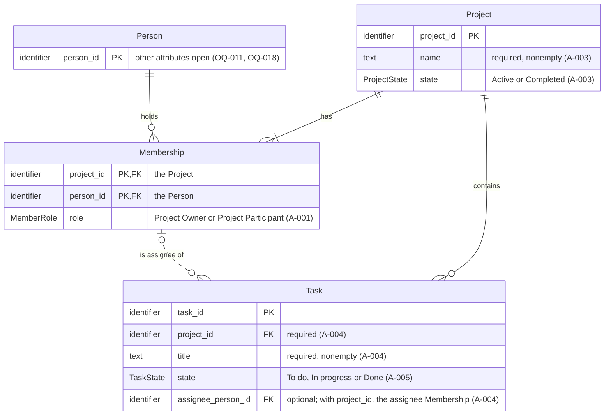

# Matriz — Data Model (v0.1)

**Status:** **Proposal pending validation — not an approved design.** The client has not approved the MVP scope ([OQ-016](constraints.md#open-questions)), and every rule below that goes beyond F01–F03 rests on an unvalidated assumption. The model was prepared on request before the client validation that [AGENTS.md](../AGENTS.md#current-phase-and-next-steps) plans to come first. It is a logical model only: it names no database technology or storage approach, defines no physical schema, and implements nothing. Terminology follows the [glossary](requirements.md#glossary).

The model covers only the proposed MVP, [FR-001–FR-012](requirements.md#functional-requirements) ([Assumption A-012](constraints.md#assumptions)), and the data on which [NFR-001–NFR-003](requirements.md#non-functional-requirements-and-unresolved-quality-criteria) depend. Nothing is modelled for the candidates [outside the initial scope](requirements.md#outside-the-initial-scope). Requirements and acceptance criteria are linked, not repeated.

## Entities

| Entity | Represents | Identifier | Stored attributes |
|---|---|---|---|
| Person | A person known to the application, to whom memberships and assignments refer ([NFR-001](requirements.md#non-functional-requirements-and-unresolved-quality-criteria); [Assumption A-014](constraints.md#assumptions)). | `person_id` | None specified. Which data identify or display a person, and whether Matriz holds them or refers to an existing identity source, are open ([OQ-011](constraints.md#open-questions), [OQ-018](constraints.md#open-questions)). |
| Project | A [Project](requirements.md#glossary) (F01). | `project_id` | `name`: required and nonempty ([Assumption A-003](constraints.md#assumptions)). `state`: Active or Completed ([Assumption A-003](constraints.md#assumptions)). |
| Membership | A person's membership of a project, which makes them a [Member](requirements.md#glossary) with access to it ([Assumption A-002](constraints.md#assumptions)). | `project_id` + `person_id`: at most one Membership per person and project, because Project Owner and Project Participant are distinct per-project roles ([Assumption A-001](constraints.md#assumptions)). | `role`: Project Owner or Project Participant ([Assumption A-001](constraints.md#assumptions)). |
| Task | A [Task](requirements.md#glossary) (F02). | `task_id` | `project_id`: required; the project the task belongs to ([Assumption A-004](constraints.md#assumptions)). `title`: required and nonempty ([Assumption A-004](constraints.md#assumptions)). `state`: To do, In progress, or Done ([Assumption A-005](constraints.md#assumptions)). `assignee_person_id`: optional; with `project_id`, it identifies the assignee's Membership ([Assumption A-004](constraints.md#assumptions)). |

- `project_id` and `task_id` carry no business meaning, because names and titles can change ([FR-003](requirements.md#functional-requirements), [FR-009](requirements.md#functional-requirements)) and whether they must be unique is open ([OQ-003](constraints.md#open-questions)). No uniqueness is assumed for `name` or `title`.
- Ownership is the `role` of a Membership, not a separate reference on Project, so the Project Owner is a member by construction ([Assumption A-002](constraints.md#assumptions), [Assumption A-008](constraints.md#assumptions)) and a person can hold different roles in different projects ([Assumption A-001](constraints.md#assumptions)).
- The assignee is an optional reference on Task, not a separate entity, because at most one assignee is recorded and no assignment history is required ([FR-010](requirements.md#functional-requirements); [Assumption A-004](constraints.md#assumptions)).

## Relationships

| Relationship | Cardinality and optionality | Basis |
|---|---|---|
| Person – Membership | Each Person holds `0..*` Memberships (optional); each Membership belongs to `1` Person (mandatory). | A person need not belong to any project; for example, a person authorized to create projects may not have created one yet ([US-001](user-stories.md#stories)). |
| Project – Membership | Each Project has `1..*` Memberships (mandatory), exactly one with role Project Owner (rule 1); each Membership belongs to `1` Project (mandatory). | The creator's Membership exists from creation ([FR-002](requirements.md#functional-requirements); [Assumption A-008](constraints.md#assumptions)), and no MVP requirement removes it ([FR-005](requirements.md#functional-requirements); [Assumption A-009](constraints.md#assumptions)). |
| Project – Task | Each Project contains `0..*` Tasks (optional); each Task belongs to `1` Project (mandatory). | A project can have no tasks ([US-006](user-stories.md#acceptance-criteria), [EX-005](user-stories.md#edge-cases-and-exceptions)); a task belongs to exactly one project ([Assumption A-004](constraints.md#assumptions)). |
| Membership – Task | Each Membership is the assignee of `0..*` Tasks (optional); each Task has `0..1` assignee Membership (optional), from the Task's own Project. | A task may be unassigned and has at most one assignee, chosen from its project's members ([FR-008](requirements.md#functional-requirements), [FR-010](requirements.md#functional-requirements); [Assumption A-004](constraints.md#assumptions)); no requirement limits the number of tasks per assignee. |

Through Membership, Person and Project are related many-to-many; a person can be Project Owner in some projects and Project Participant in others ([Assumption A-001](constraints.md#assumptions)).

## ER diagram

- Next to an entity, `||` means exactly one, `|o` zero or one, `|{` one or more, and `o{` zero or more instances of that entity for each instance at the other end of the line.
- A solid line joins an entity to one it cannot exist without; the dashed line is the optional assignment.
- `PK` marks identifiers and `FK` references to another entity; attribute types are conceptual value sets. None of these implies a storage technology.
- Assumption IDs in the diagram refer to the [assumption register](constraints.md#assumptions); all are unvalidated.

## Rules not shown in the diagram

ER cardinality markers cannot express these rules.

1. **One Project Owner.** Exactly one Membership of each Project has role Project Owner: its creator's, recorded when the Project is created ([FR-002](requirements.md#functional-requirements); [Assumption A-001](constraints.md#assumptions), [Assumption A-008](constraints.md#assumptions)). Members added later are Project Participants ([US-002](user-stories.md#stories)). No MVP requirement adds another owner, transfers ownership, or removes the owner ([FR-005](requirements.md#functional-requirements); [OQ-002](constraints.md#open-questions), [OQ-008](constraints.md#open-questions)).
2. **Member removal.** A Membership can be removed only if its role is Project Participant, its Project is Active, and no Task references it as assignee ([FR-005](requirements.md#functional-requirements); [Assumption A-009](constraints.md#assumptions)). Removal ends the person's access ([Assumption A-002](constraints.md#assumptions)); only current memberships are recorded.
3. **Initial values.** A new Project is Active ([FR-002](requirements.md#functional-requirements); [Assumption A-003](constraints.md#assumptions)); a new Task is To do and may have no assignee ([FR-008](requirements.md#functional-requirements); [Assumption A-004](constraints.md#assumptions), [Assumption A-010](constraints.md#assumptions)).
4. **State changes.** The only specified Project change of state is from Active to Completed, by its Project Owner, when none of its Tasks is To do or In progress ([FR-007](requirements.md#functional-requirements); [Assumption A-003](constraints.md#assumptions), [Assumption A-007](constraints.md#assumptions)); reopening is open ([OQ-006](constraints.md#open-questions)). A Task's state can change between any of its three values ([FR-011](requirements.md#functional-requirements); [Assumption A-005](constraints.md#assumptions)).
5. **Completed projects are read-only.** While a Project is Completed, the Project does not change, and none of its Memberships or Tasks is added, removed, or changed ([FR-004](requirements.md#functional-requirements), [FR-005](requirements.md#functional-requirements), [FR-008](requirements.md#functional-requirements); [Assumption A-011](constraints.md#assumptions)). With rule 4, every Task of a Completed Project is therefore Done, provided simultaneous changes are resolved consistently ([OQ-017](constraints.md#open-questions)).

## Stored and derived data

Only the attributes in the diagram are stored. Everything else that the MVP shows or checks is derived from them when needed and is not stored, so it cannot diverge from the stored data.

| Derived value | Derived from | Used by |
|---|---|---|
| Task counts by state, percentage Done, or “No tasks” | `state` of the project's Tasks | [FR-012](requirements.md#functional-requirements), [EX-005](user-stories.md#edge-cases-and-exceptions); [Assumption A-006](constraints.md#assumptions) |
| Whether a project has unfinished tasks | Any of its Tasks in To do or In progress | [FR-007](requirements.md#functional-requirements); [Assumption A-007](constraints.md#assumptions) |
| Whether a member has assigned tasks | Any Task referencing their Membership | [FR-005](requirements.md#functional-requirements); [Assumption A-009](constraints.md#assumptions) |
| A person's accessible projects; a project's members and its Project Owner | Memberships and their `role` | [FR-001](requirements.md#functional-requirements), [US-001](user-stories.md#acceptance-criteria), [US-002](user-stories.md#acceptance-criteria); [Assumption A-002](constraints.md#assumptions) |
| Whether a task is unassigned | Absence of an assignee reference | [FR-006](requirements.md#functional-requirements), [FR-008](requirements.md#functional-requirements) |
| Whether a person may view or change a project or task | Membership, `role`, the Task's assignee, and the Project's `state` | [NFR-002](requirements.md#non-functional-requirements-and-unresolved-quality-criteria); [Assumption A-001](constraints.md#assumptions), [Assumption A-002](constraints.md#assumptions), [Assumption A-011](constraints.md#assumptions); enforcement is open ([OQ-019](constraints.md#open-questions)) |

Project `state` is stored rather than derived: Completed records the Project Owner's decision ([FR-007](requirements.md#functional-requirements)); task states only determine whether that decision is allowed.

## Consistency review

### Requirement coverage

| Requirement | Model elements |
|---|---|
| [FR-001](requirements.md#functional-requirements) | The person's Memberships; Project `state` (Completed projects stay listed) |
| [FR-002](requirements.md#functional-requirements) | New Project (Active) and its creator's Membership (Project Owner); authorization to create projects is not represented ([OQ-001](constraints.md#open-questions)) |
| [FR-003](requirements.md#functional-requirements) | Project `name` |
| [FR-004](requirements.md#functional-requirements) | New Membership (Project Participant) |
| [FR-005](requirements.md#functional-requirements) | Membership removal (rule 2) |
| [FR-006](requirements.md#functional-requirements) | Task `title`, `state`, and assignee |
| [FR-007](requirements.md#functional-requirements) | Project `state`; derived unfinished-task check (rule 4) |
| [FR-008](requirements.md#functional-requirements) | New Task (To do, no assignee required) |
| [FR-009](requirements.md#functional-requirements) | Task `title` |
| [FR-010](requirements.md#functional-requirements) | Assignee reference to a Membership of the task's project |
| [FR-011](requirements.md#functional-requirements) | Task `state`; permission derived from `role` and assignee |
| [FR-012](requirements.md#functional-requirements) | Derived values only |
| [NFR-001](requirements.md#non-functional-requirements-and-unresolved-quality-criteria) | `person_id` as the reference to an identified person ([OQ-018](constraints.md#open-questions)) |
| [NFR-002](requirements.md#non-functional-requirements-and-unresolved-quality-criteria) | Membership, `role`, assignee, and Project `state` |
| [NFR-003](requirements.md#non-functional-requirements-and-unresolved-quality-criteria) | Memberships and assignments link people to projects and tasks; what personal data is processed and which obligations apply is open ([OQ-011](constraints.md#open-questions)) |

### Findings

| Check | Result |
|---|---|
| Membership and ownership | Consistent with [Assumption A-001](constraints.md#assumptions), [Assumption A-002](constraints.md#assumptions), and [Assumption A-008](constraints.md#assumptions). **Flag:** “exactly one Project Owner” (rule 1) is inferred from the singular “its Project Owner” and from the absence of any way to add, transfer, or remove an owner; it is not stated explicitly ([OQ-002](constraints.md#open-questions), [OQ-008](constraints.md#open-questions)). |
| Tasks belong to projects | Consistent with [Assumption A-004](constraints.md#assumptions): each Task has exactly one Project; no MVP requirement moves a task between projects. |
| Optional assignee | Consistent with [Assumption A-004](constraints.md#assumptions) and [Assumption A-009](constraints.md#assumptions): the reference includes the Task's `project_id`, so only a member of that project can be recorded, and a referenced Membership cannot be removed. Any member, including the Project Owner, can be the assignee ([FR-010](requirements.md#functional-requirements) uses lower-case “participants”; see [glossary](requirements.md#glossary)); [US-012](user-stories.md#stories) illustrates only the Project Participant case. Changing or clearing an assignee is open ([OQ-007](constraints.md#open-questions)). |
| Project and task states | Consistent with [Assumption A-003](constraints.md#assumptions), [Assumption A-005](constraints.md#assumptions), and [Assumption A-010](constraints.md#assumptions). **Flag:** [US-005](user-stories.md#acceptance-criteria) expects a reopened task to show “In progress (reopened)”; the model stores no reopening indicator and reads “(reopened)” as describing the change. If reopened tasks must be marked, additional data is needed ([OQ-004](constraints.md#open-questions)). |
| Progress | Derived only ([Assumption A-006](constraints.md#assumptions)). **Flag:** rounding of the percentage (for example, 1 of 3 tasks Done) is not specified; it affects presentation, not stored data ([OQ-005](constraints.md#open-questions)). |
| Member removal over time | **Flag:** without reassignment or unassignment ([OQ-007](constraints.md#open-questions)), and with no task deletion in the MVP, a Project Participant who has been assigned any task, even a Done one, can never be removed from that project (rule 2; [Assumption A-009](constraints.md#assumptions)). |
| Gaps left open | No data identifies or displays a person, although [US-002](user-stories.md#acceptance-criteria), [US-004](user-stories.md#acceptance-criteria), and [US-009](user-stories.md#acceptance-criteria) expect members and assignees to be recognizable ([OQ-011](constraints.md#open-questions), [OQ-018](constraints.md#open-questions)). No timestamps, history, or audit data are defined, because no MVP requirement uses them (retention: [OQ-011](constraints.md#open-questions)). Simultaneous changes may require additional data ([OQ-017](constraints.md#open-questions)). |
| Architecture | Data ownership matches the provisional [architecture definition](architecture.md#components-and-responsibilities): Person in Identity; Project and Membership in Projects; Task in Tasks; none in Progress or Access control. The Task-to-Membership reference matches the dependency of Tasks on Projects. The architecture is itself provisional ([OQ-016](constraints.md#open-questions)) and leaves data storage undecided; this model does not depend on it. |

**Diagram check.** Each relationship line was compared with [Relationships](#relationships) (both cardinality markers, and a solid line exactly where the entity at the many end cannot exist without the other), and each attribute with [Entities](#entities). Rules 1–5 cannot be expressed with ER cardinality markers and are stated only in the text.

## Open questions affecting the model

None of these is answered here; see the [open questions](constraints.md#open-questions) register.

| Question | Possible effect on the model |
|---|---|
| [OQ-016](constraints.md#open-questions) | Until the client approves the MVP scope, this model remains a proposal; scope changes may add, remove, or reshape entities. |
| [OQ-001](constraints.md#open-questions) | Data on who may create projects and how people receive access. |
| [OQ-002](constraints.md#open-questions) | Values of `role`, and rule 1. |
| [OQ-003](constraints.md#open-questions) | Constraints on `name` and `title`, including uniqueness. |
| [OQ-004](constraints.md#open-questions) | Values and initial value of Task `state`; any record of reopening. |
| [OQ-005](constraints.md#open-questions) | Derived progress values and their rounding; a different measure could require new Task attributes. |
| [OQ-006](constraints.md#open-questions) | Project state changes: completing a project with no tasks, reopening a Completed project. |
| [OQ-007](constraints.md#open-questions) | Changing or clearing the assignee; rule 2 for departing members. |
| [OQ-008](constraints.md#open-questions) | Changes to the Project Owner's Membership; access after completion (rules 1 and 5). |
| [OQ-011](constraints.md#open-questions) | Person attributes, references to people, retention, and history. |
| [OQ-012](constraints.md#open-questions) | Additional data for any required integration. |
| [OQ-017](constraints.md#open-questions) | Additional data to detect or resolve simultaneous changes. |
| [OQ-018](constraints.md#open-questions) | Whether Person records are held by Matriz or refer to an existing identity source. |
| [OQ-019](constraints.md#open-questions) | How the permissions derived from this data are enforced. |
