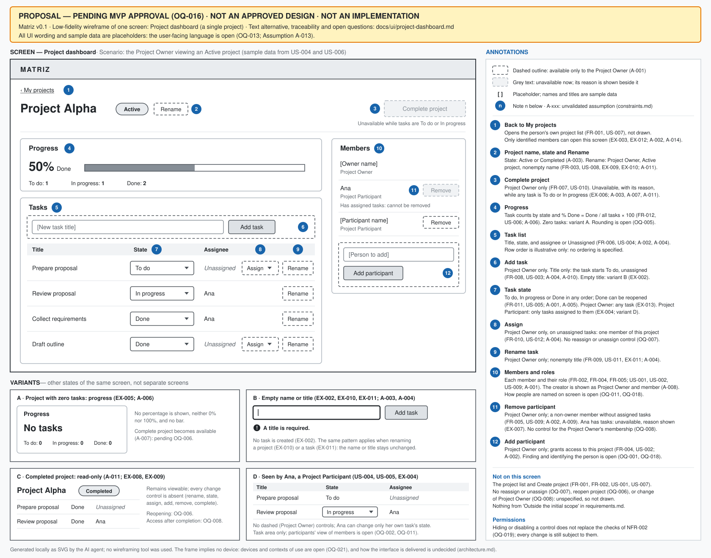

# Matriz — Wireframe: Project dashboard (drawing v0.1; notes v0.2)

**Status:** **Proposal pending MVP approval ([OQ-016](../constraints.md#open-questions)) — not an approved design and not an implementation.** It was prepared on request before client validation, and it records proposals, not decisions. All wording and sample data are placeholders. The drawing cites [Assumption A-013](../constraints.md#assumptions) (Portuguese), which the team superseded on 2026-10-29 with [Assumption A-028](../constraints.md#assumptions) (English, provisional); [OQ-013](../constraints.md#open-questions) remains open. Terms follow the [glossary](../requirements.md#glossary).

**The drawing predates the team decisions of 2026-10-29 and has not been redrawn.** Where it, or the sections below that describe it, differs from [Changes after the team decisions of 2026-10-29](#changes-after-the-team-decisions-of-2026-10-29), that section prevails.

## Screen

- **Purpose:** one project's name and state, progress, tasks, and members, within the [proposed MVP](../requirements.md#mvp-scope). It is not an overview across projects, which is [outside the initial scope](../requirements.md#outside-the-initial-scope) ([Assumption A-012](../constraints.md#assumptions)).
- **Scenario drawn:** the Project Owner viewing an Active project, with the sample tasks of [US-004 and US-006](../user-stories.md#acceptance-criteria) (four tasks, 50% Done). Variants A–D show other states of the same screen.
- **Navigation:** the screen is opened from, and links back to, the person's project list ([FR-001](../requirements.md#functional-requirements), [US-007](../user-stories.md#stories)), which is not drawn. The top bar shows only the product name.
- **How it was made:** an SVG written locally by the AI agent; no AI wireframing tool was available, so none was used. The frame implies no device: devices and contexts of use are open ([OQ-021](../constraints.md#open-questions)), and how the interface is delivered is [not decided](../architecture.md#decision-and-rationale).

## Traceability

Numbers match the markers in the wireframe; letters match its variants. Dashed outlines mark controls proposed only for the Project Owner. The wireframe's annotations abbreviate these references; this table is the complete record.

| # | Element | Requirements | Stories and cases | Assumptions |
|---|---|---|---|---|
| 1 | Back to the project list; only identified members can open the screen | [FR-001](../requirements.md#functional-requirements), [NFR-001](../requirements.md#non-functional-requirements-and-unresolved-quality-criteria), [NFR-002](../requirements.md#non-functional-requirements-and-unresolved-quality-criteria) | [US-007](../user-stories.md#stories), [EX-003](../user-stories.md#edge-cases-and-exceptions), [EX-012](../user-stories.md#edge-cases-and-exceptions) | [Assumption A-002](../constraints.md#assumptions), [Assumption A-014](../constraints.md#assumptions) |
| 2 | Project name, state, and Rename | [FR-003](../requirements.md#functional-requirements) | [US-008](../user-stories.md#stories), [EX-009](../user-stories.md#edge-cases-and-exceptions), [EX-010](../user-stories.md#edge-cases-and-exceptions) | [Assumption A-001](../constraints.md#assumptions), [Assumption A-003](../constraints.md#assumptions), [Assumption A-011](../constraints.md#assumptions) |
| 3 | Complete project, unavailable with its reason while any task is To do or In progress | [FR-007](../requirements.md#functional-requirements) | [US-010](../user-stories.md#stories), [EX-006](../user-stories.md#edge-cases-and-exceptions) | [Assumption A-003](../constraints.md#assumptions), [Assumption A-007](../constraints.md#assumptions), [Assumption A-011](../constraints.md#assumptions) |
| 4 | Progress: task counts by state and percentage Done | [FR-012](../requirements.md#functional-requirements) | [US-006](../user-stories.md#stories) | [Assumption A-006](../constraints.md#assumptions) |
| 5 | Task list: title, state, and assignee or Unassigned | [FR-006](../requirements.md#functional-requirements) | [US-004](../user-stories.md#stories) | [Assumption A-002](../constraints.md#assumptions), [Assumption A-004](../constraints.md#assumptions) |
| 6 | Add task, with a title only | [FR-008](../requirements.md#functional-requirements) | [US-003](../user-stories.md#stories), [EX-002](../user-stories.md#edge-cases-and-exceptions) | [Assumption A-004](../constraints.md#assumptions), [Assumption A-010](../constraints.md#assumptions) |
| 7 | Task state | [FR-011](../requirements.md#functional-requirements) | [US-005](../user-stories.md#stories), [EX-004](../user-stories.md#edge-cases-and-exceptions), [EX-013](../user-stories.md#edge-cases-and-exceptions) | [Assumption A-001](../constraints.md#assumptions), [Assumption A-005](../constraints.md#assumptions) |
| 8 | Assign, on unassigned tasks | [FR-010](../requirements.md#functional-requirements) | [US-012](../user-stories.md#stories) | [Assumption A-001](../constraints.md#assumptions), [Assumption A-004](../constraints.md#assumptions) |
| 9 | Rename task | [FR-009](../requirements.md#functional-requirements) | [US-011](../user-stories.md#stories), [EX-011](../user-stories.md#edge-cases-and-exceptions) | [Assumption A-001](../constraints.md#assumptions), [Assumption A-004](../constraints.md#assumptions) |
| 10 | Members and their roles | [FR-002](../requirements.md#functional-requirements), [FR-004](../requirements.md#functional-requirements), [FR-005](../requirements.md#functional-requirements) | [US-001](../user-stories.md#stories), [US-002](../user-stories.md#stories), [US-009](../user-stories.md#stories) | [Assumption A-001](../constraints.md#assumptions), [Assumption A-008](../constraints.md#assumptions) |
| 11 | Remove participant, unavailable with its reason for a member with assigned tasks | [FR-005](../requirements.md#functional-requirements) | [US-009](../user-stories.md#stories), [EX-007](../user-stories.md#edge-cases-and-exceptions) | [Assumption A-002](../constraints.md#assumptions), [Assumption A-009](../constraints.md#assumptions) |
| 12 | Add participant | [FR-004](../requirements.md#functional-requirements) | [US-002](../user-stories.md#stories) | [Assumption A-001](../constraints.md#assumptions), [Assumption A-002](../constraints.md#assumptions) |
| A | Zero tasks: “No tasks”, zero counts, no percentage; Complete project available | [FR-007](../requirements.md#functional-requirements), [FR-012](../requirements.md#functional-requirements) | [US-006](../user-stories.md#stories), [US-010](../user-stories.md#stories), [EX-005](../user-stories.md#edge-cases-and-exceptions) | [Assumption A-006](../constraints.md#assumptions), [Assumption A-007](../constraints.md#assumptions) |
| B | Empty name or title: message shown; nothing is created or changed | [FR-003](../requirements.md#functional-requirements), [FR-008](../requirements.md#functional-requirements), [FR-009](../requirements.md#functional-requirements) | [EX-002](../user-stories.md#edge-cases-and-exceptions), [EX-010](../user-stories.md#edge-cases-and-exceptions), [EX-011](../user-stories.md#edge-cases-and-exceptions) | [Assumption A-003](../constraints.md#assumptions), [Assumption A-004](../constraints.md#assumptions) |
| C | Completed project: viewable, with no change controls | [FR-001](../requirements.md#functional-requirements), [FR-007](../requirements.md#functional-requirements) | [US-007](../user-stories.md#stories), [EX-008](../user-stories.md#edge-cases-and-exceptions), [EX-009](../user-stories.md#edge-cases-and-exceptions) | [Assumption A-011](../constraints.md#assumptions) |
| D | A Project Participant's view: no Project Owner controls; state control only on their own task | [FR-006](../requirements.md#functional-requirements), [FR-011](../requirements.md#functional-requirements) | [US-004](../user-stories.md#stories), [US-005](../user-stories.md#stories), [EX-004](../user-stories.md#edge-cases-and-exceptions) | [Assumption A-001](../constraints.md#assumptions) |

## Design proposals (not decisions)

- Unavailable actions are shown greyed with their reason (markers 3 and 11) instead of being refused after an attempt; the outcomes of EX-006 and EX-007 hold either way.
- Add task asks only for a title, and assignment follows with Assign: [FR-008](../requirements.md#functional-requirements) does not say whether an assignee can be chosen when a task is created.
- No control is drawn for unspecified behaviour: reassigning or unassigning a task (OQ-007), reopening a project (OQ-006), or changing the Project Owner's membership (OQ-008).
- The progress bar only repeats the percentage and is omitted when there are no tasks. Task order is illustrative; none is specified.
- The Project Owner sees the member list, which US-001, US-002, and US-009 expect; whether Project Participants see it is open (OQ-002, OQ-011), so variant D shows tasks only.
- Hiding or disabling a control does not replace the permission checks of [NFR-002](../requirements.md#non-functional-requirements-and-unresolved-quality-criteria) (OQ-019).

## Open questions affecting the design

None is answered here; see the [open questions](../constraints.md#open-questions) register.

| Question | Effect on this screen |
|---|---|
| [OQ-016](../constraints.md#open-questions) | The whole screen remains a proposal until the MVP scope is approved. |
| [OQ-013](../constraints.md#open-questions) | Final wording and language(s); label lengths may change the layout. |
| [OQ-021](../constraints.md#open-questions) | Layout for the devices and contexts of use; two columns are drawn here only as an example. |
| [OQ-002](../constraints.md#open-questions) | Which controls each role sees; whether Project Participants see the member list. |
| [OQ-001](../constraints.md#open-questions), [OQ-011](../constraints.md#open-questions), [OQ-018](../constraints.md#open-questions) | How a person is found when added, and how members and assignees are named on screen ([data model findings](../database.md#findings)). |
| [OQ-003](../constraints.md#open-questions) | Validation messages beyond “required” (whitespace-only, duplicate, or long names and titles). |
| [OQ-004](../constraints.md#open-questions) | State options, and whether a reopened task needs a visible marker ([US-005](../user-stories.md#acceptance-criteria) mentions “(reopened)”). |
| [OQ-005](../constraints.md#open-questions) | What progress shows, and how the percentage is rounded (for example, 1 of 3 tasks Done). |
| [OQ-006](../constraints.md#open-questions) | Complete project with zero tasks (variant A); reopening; whether completing needs a confirmation step if it cannot be undone. |
| [OQ-007](../constraints.md#open-questions) | Reassign and unassign controls. Under the current proposal, a member who has any assigned task, even a Done one, can never be removed ([data model findings](../database.md#findings)), so Ana's Remove stays unavailable. |
| [OQ-008](../constraints.md#open-questions) | Controls for the Project Owner's membership; access to a Completed project (variant C). |
| [OQ-010](../constraints.md#open-questions) | Accessibility needs ([NFR-007](../requirements.md#non-functional-requirements-and-unresolved-quality-criteria)) that the controls, contrast, and messages must meet. |
| [OQ-017](../constraints.md#open-questions) | What the screen shows when someone else has changed the same project or task in the meantime. |
| [OQ-019](../constraints.md#open-questions) | How refused changes are enforced and reported beyond what the screen hides. |

## Review against the proposed MVP

Reviewed on 2026-10-26:

- Every requirement FR-001–FR-012 is represented. Creating a project (FR-002, EX-001) is not on this screen; only its result appears here: the creator shown as Project Owner (US-001).
- Navigation is limited to the project list. Every visible element and control maps to a requirement and story above.
- Nothing [outside the initial scope](../requirements.md#outside-the-initial-scope) is drawn: no comments, notifications, subtasks, dependencies, attachments, or cross-project overview. Search, filters, sorting, deletion, and profile controls are also absent, because no requirement specifies them.
- The SVG is well-formed and renders in Google Chrome and macOS Quick Look without overflowing or overlapping text.

## Changes after the team decisions of 2026-10-29

The project team's provisional decisions of 2026-10-29 ([ADR-002](../adr/ADR-002-phase-scope-and-implementation-authorization.md)) change this screen and add screens that are not drawn. The SVG is unchanged. Redrawing it, and drawing the sign-in screen, My projects, and the task detail, is deferred [Proposal]. The last column names the [implementation plan](../implementation-plan.md) increment that builds each change.

| # | Change | Requirements | Stories and cases | Assumptions | Increment |
|---|---|---|---|---|---|
| Top bar | Shows the signed-in person's display name and Sign out. A person who is not signed in sees the sign-in screen (not drawn) instead of this screen. | [FR-013](../requirements.md#functional-requirements), [FR-014](../requirements.md#functional-requirements), [FR-015](../requirements.md#functional-requirements) | [US-013](../user-stories.md#stories), [US-014](../user-stories.md#stories), [US-015](../user-stories.md#stories), [EX-012](../user-stories.md#edge-cases-and-exceptions), [EX-014](../user-stories.md#edge-cases-and-exceptions) | [Assumption A-016](../constraints.md#assumptions), [Assumption A-017](../constraints.md#assumptions) | I2 |
| 1 | Back to My projects, which is the person's project list. | [FR-024](../requirements.md#functional-requirements) | [US-025](../user-stories.md#stories) | [Assumption A-025](../constraints.md#assumptions) | I5 |
| 2 | Adds Delete project for the Project Owner of an Active project, after confirming. Rename is unchanged. | [FR-016](../requirements.md#functional-requirements) | [US-016](../user-stories.md#stories), [EX-015](../user-stories.md#edge-cases-and-exceptions), [EX-016](../user-stories.md#edge-cases-and-exceptions) | [Assumption A-022](../constraints.md#assumptions) | I10 |
| 4 | The percentage is rounded to a whole number, halves up. Deleted tasks are not counted, and task filters do not change progress. | [FR-012](../requirements.md#functional-requirements), [FR-023](../requirements.md#functional-requirements) | [US-006](../user-stories.md#stories), [EX-026](../user-stories.md#edge-cases-and-exceptions), [EX-027](../user-stories.md#edge-cases-and-exceptions) | [Assumption A-022](../constraints.md#assumptions), [Assumption A-024](../constraints.md#assumptions), [Assumption A-026](../constraints.md#assumptions) | I5, I10, I11 |
| 5 | Each task shows its Task priority and all of its assignees, or Unassigned, and opens its task detail. Filters by one or more states and one or more Task priorities are added to the list. | [FR-006](../requirements.md#functional-requirements), [FR-018](../requirements.md#functional-requirements), [FR-023](../requirements.md#functional-requirements) | [US-004](../user-stories.md#stories), [US-018](../user-stories.md#stories), [US-024](../user-stories.md#stories), [EX-026](../user-stories.md#edge-cases-and-exceptions) | [Assumption A-019](../constraints.md#assumptions), [Assumption A-021](../constraints.md#assumptions), [Assumption A-024](../constraints.md#assumptions) | I4, I7, I11 |
| 6 | Add task may also set the Task priority; Medium otherwise. | [FR-008](../requirements.md#functional-requirements), [FR-018](../requirements.md#functional-requirements) | [US-003](../user-stories.md#stories), [US-018](../user-stories.md#stories) | [Assumption A-021](../constraints.md#assumptions) | I4 |
| 7 | Any assignee of the task can change its state, as can the Project Owner. | [FR-011](../requirements.md#functional-requirements) | [US-005](../user-stories.md#stories), [EX-004](../user-stories.md#edge-cases-and-exceptions), [EX-013](../user-stories.md#edge-cases-and-exceptions) | [Assumption A-019](../constraints.md#assumptions) | I7 |
| 8 | Assign is available on every task, not only unassigned ones, and each assignee can be unassigned. The Project Owner assigns or unassigns any Eligible assignee; a Project Participant assigns or unassigns only themselves. | [FR-010](../requirements.md#functional-requirements), [FR-019](../requirements.md#functional-requirements) | [US-012](../user-stories.md#stories), [US-019](../user-stories.md#stories), [US-020](../user-stories.md#stories), [EX-020](../user-stories.md#edge-cases-and-exceptions), [EX-021](../user-stories.md#edge-cases-and-exceptions), [EX-022](../user-stories.md#edge-cases-and-exceptions) | [Assumption A-019](../constraints.md#assumptions), [Assumption A-020](../constraints.md#assumptions) | I7 |
| 9 | Rename task becomes an edit of the task's title and Task priority, and Delete task is added, after confirming; both remain Project Owner controls. | [FR-009](../requirements.md#functional-requirements), [FR-017](../requirements.md#functional-requirements), [FR-018](../requirements.md#functional-requirements) | [US-011](../user-stories.md#stories), [US-017](../user-stories.md#stories), [US-018](../user-stories.md#stories), [EX-016](../user-stories.md#edge-cases-and-exceptions), [EX-017](../user-stories.md#edge-cases-and-exceptions), [EX-018](../user-stories.md#edge-cases-and-exceptions), [EX-019](../user-stories.md#edge-cases-and-exceptions) | [Assumption A-021](../constraints.md#assumptions), [Assumption A-022](../constraints.md#assumptions) | I4, I10 |
| 10 | Every member sees the member list, not only the Project Owner. | [FR-025](../requirements.md#functional-requirements) | [US-026](../user-stories.md#stories) | [Assumption A-027](../constraints.md#assumptions) | I6 |
| 11 | The rule is unchanged, but a member's assignments can now be removed first. Ana's Remove becomes available once she is unassigned from her two tasks. | [FR-005](../requirements.md#functional-requirements), [FR-010](../requirements.md#functional-requirements) | [US-009](../user-stories.md#stories), [US-019](../user-stories.md#stories), [EX-007](../user-stories.md#edge-cases-and-exceptions) | [Assumption A-009](../constraints.md#assumptions), [Assumption A-019](../constraints.md#assumptions) | I7 |
| 12 | Add participant chooses from a searchable list of the people who are not members, shown by display name. Decided by the team on 2026-11-09, pending the client (*changed on 2026-11-09 by team decision, the I6 decisions, question 1: previously “This is a proposal that the team has not yet decided.”*). | [FR-004](../requirements.md#functional-requirements) | [US-002](../user-stories.md#stories) | [Assumption A-030](../constraints.md#assumptions) | I6 |
| B | The same pattern applies to an empty comment. | [FR-020](../requirements.md#functional-requirements) | [EX-023](../user-stories.md#edge-cases-and-exceptions) | [Assumption A-023](../constraints.md#assumptions) | I9 |
| C | A Completed project still has no change controls, except adding a comment on the task detail. | [FR-020](../requirements.md#functional-requirements) | [US-021](../user-stories.md#stories), [EX-024](../user-stories.md#edge-cases-and-exceptions) | [Assumption A-011](../constraints.md#assumptions), [Assumption A-023](../constraints.md#assumptions) | I9 |
| D | A Project Participant also sees the member list, the filters, a control to assign or unassign themselves on each task, and the state control on every task assigned to them. | [FR-011](../requirements.md#functional-requirements), [FR-019](../requirements.md#functional-requirements), [FR-023](../requirements.md#functional-requirements), [FR-025](../requirements.md#functional-requirements) | [US-005](../user-stories.md#stories), [US-020](../user-stories.md#stories), [US-024](../user-stories.md#stories), [US-026](../user-stories.md#stories) | [Assumption A-020](../constraints.md#assumptions), [Assumption A-027](../constraints.md#assumptions) | I6, I7, I11 |
| Task detail (not drawn) | Title, state, Task priority, assignees, and comments, oldest first, each with its text, its author's display name, and the date and time it was added; any member can add a comment. | [FR-006](../requirements.md#functional-requirements), [FR-020](../requirements.md#functional-requirements), [FR-021](../requirements.md#functional-requirements) | [US-004](../user-stories.md#stories), [US-021](../user-stories.md#stories), [US-022](../user-stories.md#stories), [EX-023](../user-stories.md#edge-cases-and-exceptions), [EX-024](../user-stories.md#edge-cases-and-exceptions) | [Assumption A-017](../constraints.md#assumptions), [Assumption A-023](../constraints.md#assumptions) | I4, I9 |
| My projects (not drawn) | Every accessible project, Active or Completed, with its name, state, and task counts by state, linking to this screen, and a search by name. No totals across projects. | [FR-001](../requirements.md#functional-requirements), [FR-022](../requirements.md#functional-requirements), [FR-024](../requirements.md#functional-requirements) | [US-007](../user-stories.md#stories), [US-023](../user-stories.md#stories), [US-025](../user-stories.md#stories), [EX-025](../user-stories.md#edge-cases-and-exceptions) | [Assumption A-024](../constraints.md#assumptions), [Assumption A-025](../constraints.md#assumptions) | I3, I5, I11 |

Statements above that no longer hold:

- **Design proposals:** unassigning is now specified ([Assumption A-019](../constraints.md#assumptions), [Assumption A-020](../constraints.md#assumptions)). Reopening a project (OQ-006) and changing the Project Owner's membership (OQ-008) are still unspecified and still not drawn. Project Participants now see the member list ([Assumption A-027](../constraints.md#assumptions)), so variant D no longer shows tasks only.
- **Open questions affecting the design:** OQ-002, OQ-005, OQ-007, OQ-013, OQ-017, and OQ-019 have [interim team answers](../constraints.md#interim-team-answers-2026-10-29); the questions stay open. Under the interim answer to OQ-007, Ana's Remove no longer stays unavailable forever.
- **Review against the proposed MVP:** the review covered FR-001–FR-012 only. FR-013–FR-025 are not drawn; comments, search, filters, and deletion are now in the proposed scope. Sorting and profile controls are still unspecified.

New open questions affecting this screen: [OQ-022](../constraints.md#open-questions) (Task priority values and who sets them), [OQ-023](../constraints.md#open-questions) (deletion), [OQ-024](../constraints.md#open-questions) (comments), [OQ-025](../constraints.md#open-questions) (several assignees and self-assignment), [OQ-026](../constraints.md#open-questions) (search and filter matching), and [OQ-027](../constraints.md#open-questions) (what happens when a sign-in ends).
